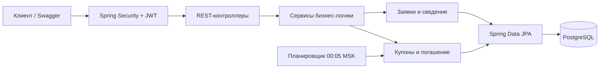

# Trading System

REST API торговой системы, выполненная как **тестовое задание для стажировки**. Приложение моделирует торговлю акциями, облигациями и валютными парами: пользователь выставляет лимитные заявки, система сводит их, ведёт позиции, операции по счёту, историю сделок и стакан.

## Возможности

- регистрация и вход по JWT;
- автоматическое создание RUB-счёта при регистрации;
- инструменты типов «акция», «облигация» и валютная пара;
- лимитные заявки BUY и SELL;
- резервирование денег, бумаг или базовой валюты;
- сведение заявок по правилу price-time priority;
- частичное исполнение и отмена активной заявки;
- стакан с агрегацией объёмов по уровням цен;
- история сделок, операций и дневная сводка по инструменту;
- автоматическое начисление купонов и погашение облигаций;
- OpenAPI/Swagger UI, миграции Flyway и единый формат ошибок.

Текущая версия поддерживает акции, облигации в RUB и валютные пары. Для пары USDRUB базовой валютой является USD, а котируемой — RUB: цена задаётся в RUB за 1 USD. При покупке списывается RUB и начисляется USD; при продаже — наоборот. Пользователь открывает нужный валютный счёт отдельной ручкой.  Для облигации хранятся номинал, дата погашения, годовая ставка купона, периодичность и ближайшая дата купона. Купоны начисляются по ближайшей дате купона, а в дату погашения активные заявки снимаются, владельцам выплачивается номинал и инструмент деактивируется. Пополнение счёта и выдача бумаг не представлены публичными API: в реальной системе это отдельные брокерские процессы.

## Архитектура



Контроллеры принимают и валидируют HTTP-запросы, сервисы реализуют правила предметной области, а репозитории сохраняют данные в PostgreSQL. Модуль `order` отвечает за резервы и сведение заявок; `corporate` обрабатывает купоны и погашение облигаций. Flyway применяет миграции при старте приложения.

## Технологии

- Java 21 и Spring Boot 3.5.16;
- Spring Security, JWT;
- Spring Data JPA, Hibernate, PostgreSQL 17, Flyway;
- Maven;
- Docker Compose;
- springdoc-openapi.

## Запуск в Docker

1. Создайте локальный файл окружения:

~~~bash
cp .env.example .env
~~~

2. Сгенерируйте секрет JWT и внесите его значением JWT_SECRET в .env:

~~~bash
openssl rand -base64 32
~~~

3. Запустите приложение и PostgreSQL:

~~~bash
docker compose up --build
~~~

После запуска:

- API: http://localhost:8080
- Swagger UI: http://localhost:8080/docs
- Health check: http://localhost:8080/actuator/health

Остановка контейнеров:

~~~bash
docker compose down
~~~

Данные PostgreSQL хранятся в Docker volume postgres_data. Удалить их вместе с контейнерами можно командой docker compose down -v.

## Конфигурация

Шаблон переменных находится в [.env.example](.env.example).

| Переменная | Назначение | По умолчанию |
| --- | --- | --- |
| JWT_SECRET | Base64-секрет для подписи JWT | обязательно |
| JWT_EXPIRATION_SECONDS | время жизни токена | 3600 |
| POSTGRES_DB | имя базы данных | trading |
| POSTGRES_USER | пользователь PostgreSQL | trading |
| POSTGRES_PASSWORD | пароль PostgreSQL | trading |
| POSTGRES_PORT | внешний порт PostgreSQL | 5432 |
| APP_PORT | внешний порт приложения | 8080 |
| BOOTSTRAP_ADMIN_EMAIL | email администратора при старте | необязательно |
| BOOTSTRAP_ADMIN_PASSWORD | пароль администратора | необязательно |

Для запуска без Docker нужны PostgreSQL, переменные DB_URL, DB_USER, DB_PASSWORD и JWT_SECRET:

~~~bash
JWT_SECRET=<base64-секрет> ./mvnw spring-boot:run
~~~

## Авторизация

Открытые маршруты:

| Метод | Маршрут | Назначение |
| --- | --- | --- |
| POST | /api/v1/auth/register | регистрация пользователя и создание RUB-счёта |
| POST | /api/v1/auth/login | получение JWT |
| GET | /docs | Swagger UI |
| GET | /actuator/health | проверка работоспособности |

Пример регистрации:

~~~json
{
  "email": "investor@example.com",
  "password": "password123"
}
~~~

Ответ входа содержит accessToken. Передавайте его во все защищённые запросы:

~~~http
Authorization: Bearer <accessToken>
~~~

В Swagger UI нажмите Authorize, вставьте только accessToken и подтвердите: префикс Bearer будет добавлен автоматически.

## Примеры curl

Во всех примерах приложение доступно по `http://localhost:8080`.

Регистрация пользователя:

```bash
curl -i -X POST http://localhost:8080/api/v1/auth/register \
  -H "Content-Type: application/json" \
  --data @- <<JSON
{"email":"investor@example.com","password":"password123"}
JSON
```

Вход и получение токена:

```bash
curl -X POST http://localhost:8080/api/v1/auth/login \
  -H "Content-Type: application/json" \
  --data @- <<JSON
{"email":"investor@example.com","password":"password123"}
JSON
```

Скопируйте поле `accessToken` из ответа в переменную `TOKEN`. Далее его можно использовать в защищённых запросах:

```bash
TOKEN="<accessToken>"

curl http://localhost:8080/api/v1/instruments \
  -H "Authorization: Bearer $TOKEN"
```

Создание лимитной заявки:

```bash
curl -i -X POST http://localhost:8080/api/v1/orders \
  -H "Authorization: Bearer $TOKEN" \
  -H "Content-Type: application/json" \
  --data @- <<JSON
{"ticker":"SBER","side":"BUY","price":250.00,"quantity":10}
JSON
```

Создание облигации доступно только администратору. Сначала получите токен учётной записи, заданной через `BOOTSTRAP_ADMIN_EMAIL` и `BOOTSTRAP_ADMIN_PASSWORD`, затем подставьте его вместо `ADMIN_TOKEN`:

```bash
ADMIN_TOKEN="<adminAccessToken>"

curl -i -X POST http://localhost:8080/api/v1/admin/instruments \
  -H "Authorization: Bearer $ADMIN_TOKEN" \
  -H "Content-Type: application/json" \
  --data @- <<JSON
{
  "ticker":"OFZ26238",
  "name":"ОФЗ 26238",
  "lotSize":1,
  "minStep":0.01,
  "currency":"RUB",
  "type":"BOND",
  "nominal":1000.00,
  "maturityDate":"2041-05-15",
  "couponRate":12.50,
  "couponFrequencyMonths":6,
  "nextCouponDate":"2027-05-15"
}
JSON
```

## Валютные пары

Для торговли парой нужно иметь оба счёта. Откройте, например, USD-счёт:

```bash
curl -i -X POST http://localhost:8080/api/v1/accounts \
  -H "Authorization: Bearer " \
  -H "Content-Type: application/json" \
  --data {"currency":"USD"}
```

Создание пары доступно администратору:

```json
{"ticker":"USDRUB","name":"US Dollar / Russian Ruble","lotSize":1,"minStep":0.0001,"currency":"RUB","type":"CURRENCY_PAIR","baseCurrency":"USD","quoteCurrency":"RUB"}
```

Покупка `USDRUB` резервирует RUB и при исполнении зачисляет USD. Продажа резервирует USD и при исполнении зачисляет RUB. В истории операций отражаются четыре движения `FX_*` — по базовому и котируемому счетам обеих сторон сделки.

## API

Все маршруты этого раздела требуют JWT.

### Пользовательские данные

| Метод | Маршрут | Описание |
| --- | --- | --- |
| POST | /api/v1/accounts | открыть счёт в валюте |
| GET | /api/v1/accounts | собственные счета |
| GET | /api/v1/accounts/operations?page=0&size=50 | история операций |
| GET | /api/v1/positions | собственные позиции |
| GET | /api/v1/trades?page=0&size=50 | собственные сделки |

### Инструменты и рынок

| Метод | Маршрут | Описание |
| --- | --- | --- |
| GET | /api/v1/instruments | список активных инструментов |
| GET | /api/v1/instruments/{ticker} | инструмент |
| GET | /api/v1/instruments/{ticker}/order-book | стакан |
| GET | /api/v1/instruments/{ticker}/trades?page=0&size=50 | история сделок |
| GET | /api/v1/instruments/{ticker}/summary | дневная сводка |

### Заявки

| Метод | Маршрут | Описание |
| --- | --- | --- |
| GET | /api/v1/orders | собственные заявки |
| POST | /api/v1/orders | создать заявку |
| DELETE | /api/v1/orders/{orderId} | отменить собственную активную заявку |

Пример заявки:

~~~json
{
  "ticker": "SBER",
  "side": "BUY",
  "price": 250.00,
  "quantity": 10
}
~~~

Количество должно быть кратно лоту инструмента, а цена — его минимальному шагу.

### Администрирование

Эти маршруты требуют роль ADMIN:

| Метод | Маршрут | Описание |
| --- | --- | --- |
| POST | /api/v1/admin/instruments | добавить инструмент |
| PATCH | /api/v1/admin/instruments/{ticker}/status | изменить активность инструмента |

Администратор может быть создан один раз при старте с помощью BOOTSTRAP_ADMIN_EMAIL и BOOTSTRAP_ADMIN_PASSWORD.

## Торговые правила

Основные сущности: User, Account, Instrument, Position, Order, Trade и AccountOperation.

Для акций и облигаций при покупке резервируется сумма price × quantity, а при продаже — количество бумаг. Для валютной пары покупка резервирует котируемую валюту, продажа — базовую. Если заявки пересекаются по цене, система выбирает сначала лучшую цену, а при равной цене — более раннюю заявку. Цена сделки берётся из уже находившейся в стакане заявки.

Неисполненный остаток остаётся в стакане. При отмене заявки резерв освобождается. Для счетов и позиций применяется optimistic locking, а при выборе встречных заявок блокируются строки базы данных.

## Ошибки API

Ошибки бизнес-логики и валидации возвращаются в едином формате:

~~~json
{
  "status": 400,
  "code": "INVALID_LOT_QUANTITY",
  "message": "Quantity must be a multiple of lot size",
  "timestamp": "2026-01-01T12:00:00Z",
  "fieldErrors": {}
}
~~~

Примеры кодов: INSUFFICIENT_BALANCE, INSUFFICIENT_SHARES, INVALID_LOT_QUANTITY и INVALID_PRICE_STEP.

## Тестирование

Запуск полного набора:

~~~bash
JWT_SECRET=<base64-секрет> ./mvnw clean test
~~~

Тесты включают:

- unit-тесты доменной модели и сервисов;
- интеграционные тесты репозиториев и PostgreSQL;
- интеграционные сценарии сведения заявок, включая ценовой и временной приоритет;
- HTTP-интеграционные тесты регистрации, JWT-защиты, изоляции данных и формата ошибок.

## Структура проекта

~~~text
src/main/java/ru/trading/system/
├── account/       счета
├── api/           единый формат ошибок
├── auth/          регистрация, вход, JWT
├── bootstrap/     создание администратора
├── corporate/     купоны, погашение и планировщик
├── instrument/    акции, облигации и административные операции
├── operation/     история денежных операций
├── order/         заявки, стакан и сведение
├── position/      позиции по ценным бумагам
├── trade/         сделки и рыночная статистика
└── user/          пользователи и роли
~~~
